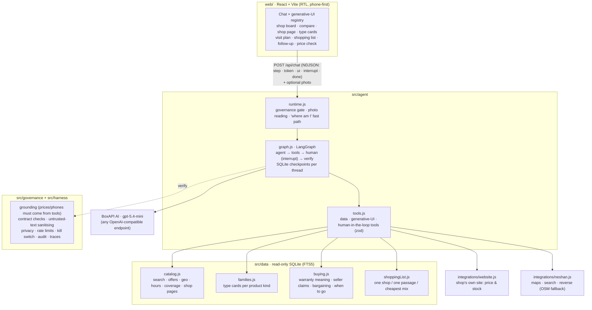

# ترب‌چین · in-person shopping agent (Tehran)

**ترب‌چین** ("the one who goes and picks the radishes") helps people buy things **in person** from Tehran's shops, passages and malls. It runs on Torob's hackathon dataset (6,476 shops · 225,903 products · 331,506 offers).

It follows four steps:
1. **Understand the need.** It helps pick a model or brand: catalogue facets, product cards per type (phone, laptop, shoes, clothing…), model-vs-model comparison, and a photo of a price tag or product.
2. **Find shops** near the user or a named place, nearest first. It also searches by kind of shop ("nearest phone shop") and opens a shop's own page with what it lists.
3. **Compare and verify.** A decision-first shop comparison, a check against the shop's own website, and a ready message for the user to ask the shop on Instagram, WhatsApp or by phone. The shop's reply goes back to the agent: out of stock leads to alternatives.
4. **Plan the trip.** The best visiting order (never arriving at a closed shop when that can be avoided), the latest time to leave, what to check in each shop, bargaining ranges, and Neshan routes. It also plans several items in one trip (one shop / one passage / cheapest mix).

Everything is done with cards, filters and buttons rather than chat alone. Every fact is labelled with its source: «ثبت‌شده در ترب», «به اعلام فروشنده», «تأیید نشده», «به گفته‌ی خودت».

## Run locally

```bash
cp .env.example .env              # LLM_API_KEY (BoxAPI AI) · optional NESHAN_* and ADMIN_TOKEN
npm install && npm run web:install
npm run db:build                  # torob-dataset.zip → data/torob.db (~35s)
npm run build                     # web → public/
npm start                         # http://localhost:3000
```

| Command | What |
|---|---|
| `npm test` | Unit tests: grounding, privacy, policy, history, catalogue, hours, shopping-list planner |
| `npm run eval` | Behavioural evals: 18 scenarios through the real agent (search, location, compare, follow-up, out of stock, shop page, model comparison, price-tag photo, bargaining, glossary, shopping list, scope, prompt injection) |
| `npm run eval -- shop-page model-compare` | Run selected scenarios by id |
| `/admin?token=$ADMIN_TOKEN` | Trace viewer (per-turn spans, latency, tokens, flags) and audit log |

CI (`.github/workflows/ci.yml`) builds the app, the database and the web bundle and runs the unit tests on every push. It also runs a short eval smoke test when the `LLM_API_KEY` secret is set.

## Architecture



**Generative UI.** The model picks a component and passes ids (and, for product cards, which of the type's fields to put first). The harness fills in the real data, so a card can never show a price, phone number or distance that isn't in the dataset. The client renders only from an allowlist registry.

**Harness rules, not hopes.** Where the prompt alone wasn't reliable (found by the evals), the graph enforces the behaviour and sends the model back with a precise instruction:
- picking a product → its shops are shown;
- nobody sells it → alternatives;
- "out of stock" → somewhere else;
- "X or Y?" → a comparison card;
- "plan my trip" → a visit plan;
- a list of items → the shopping-list planner;
- no question asked in plain text when a card should ask it;
- no claim of having contacted a shop (ترب‌چین never sends messages itself).

A confident single-model search shows its sellers straight away, which saves a whole model round.

**Governance.**
- Every price and phone number in a reply must trace back to a tool result. Violations get one retry, then redaction.
- Seller text and shop websites are treated as untrusted data: sanitised and labelled.
- Location is coarsened to about 100 m. Photos are read and then discarded, never stored.
- Phone numbers never appear in logs.
- Per-user rate limits, a kill switch (`AGENT_ENABLED=false` or `data/KILL_SWITCH`), and an append-only audit log.
- Security headers: a strict CSP that allows only the app, Torob images, OSM and Neshan; `nosniff`; and HSTS behind HTTPS.

**Transparency.**
- Listed price, price age and stock are always shown separately; stock is "unconfirmed" unless the shop itself answered.
- A shop that only declares a category is never presented as having the product.
- When the user's location is outside the dataset's coverage (it holds about 10% of Tehran's shops, from selected areas), the app says so and offers the nearest well-covered area.

## Asking a shop

Instagram only lets a business DM someone who wrote to it first, so ترب‌چین can't start a conversation with a shop. The user asks instead, in one tap:
- the shop's channels: an Instagram DM link (`ig.me`), its website, WhatsApp, phone;
- a ready message, copied when you tap a channel;
- a box to paste the reply. The reply is read for stock and price (a price is kept only if it literally appears) and handed back to the agent.

The sidebar's «پیگیری‌ها» section tracks every question asked. 22 shops in the dataset have real Instagram handles and 90 have websites; other shop names and all phone numbers in the dataset are synthetic. Locations are real.

## Deploy (Liara)

```bash
liara login
liara disk create --app torobchin --name storage --size 1   # once
liara env set --app torobchin LLM_API_KEY=... ADMIN_TOKEN=... NESHAN_WEB_KEY=... NESHAN_SERVICE_KEY=...
liara deploy
```

The Dockerfile builds the web bundle and bakes the dataset into a read-only SQLite file. The `storage` disk at `/app/storage` keeps conversations, follow-ups, traces and the audit log across deploys. `liara.json` sets the platform, port, timezone (Asia/Tehran) and disk.
