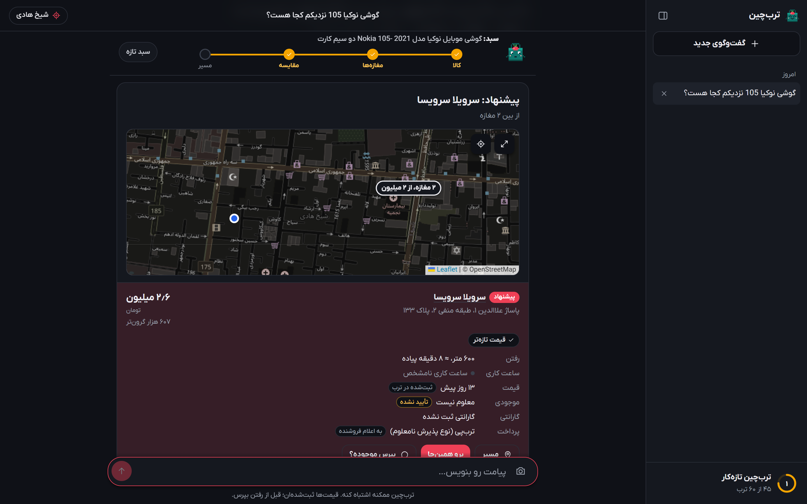
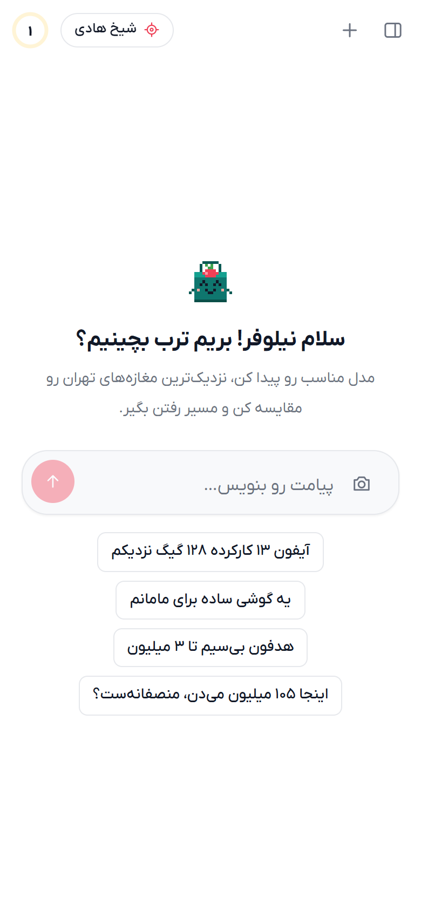
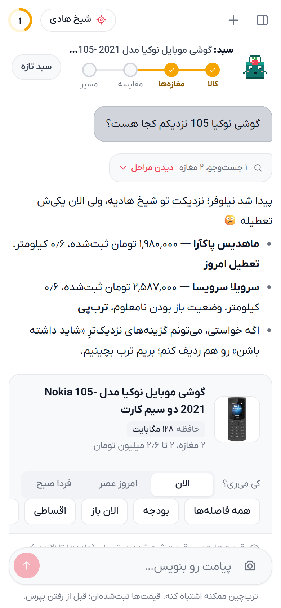
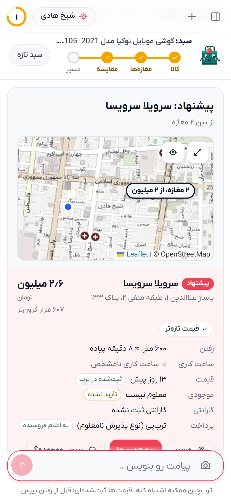
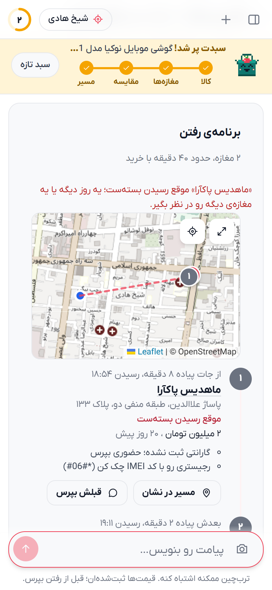
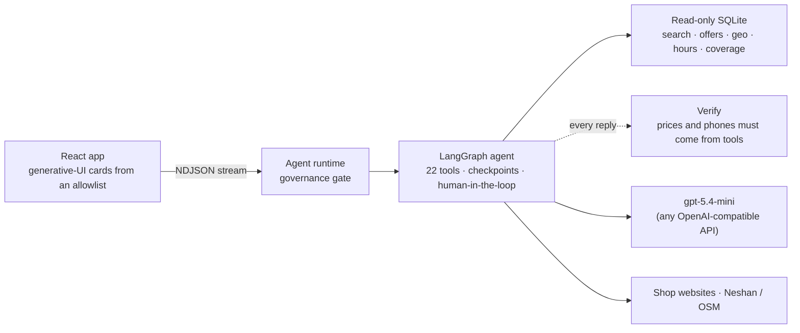

<div align="center">


# ترب‌چین

**An AI agent for buying things in person in Tehran's shops and passages.**<br/>
It goes from «یه گوشی ساده برای مامانم» to *which shop, which floor, when to leave, and what to check at the counter*.

**[torobchin.liara.run](https://torobchin.liara.run)** · [For judges](SUBMISSION.md) · [Architecture](docs/architecture.md) · [Data and its limits](docs/data.md) · [Evaluation](docs/evaluation.md)



</div>

## Why

Online, Torob tells you the price. In a passage, the questions are different: *Is it open when I get there? Do they actually have it? Is this price fair? If they don't, where's the next shop?* People answer them by calling around and walking floor to floor.

ترب‌چین answers them for you. It is built on Torob's hackathon dataset (6,476 shops · 225,903 products · 331,506 offers), it's honest about what that data can and can't tell you, and it's Persian, right-to-left and made for a phone in your hand.

## The four steps

<table>
<tr>
<td width="25%" valign="top"></td>
<td width="25%" valign="top"></td>
<td width="25%" valign="top"></td>
<td width="25%" valign="top"></td>
</tr>
<tr>
<td valign="top"><b>1. Understand the need.</b> Vague needs become real choices. It shows cards per product type with the specs that matter, «X بهتره یا Y؟» comparisons, and reads a photo of a price tag.</td>
<td valign="top"><b>2. Find shops nearby.</b> Nearest sellers on a live map linked to the list. Filters for radius, budget, open now, payment and warranty, plus «کی می‌ری؟» (now / this evening / tomorrow). Nothing needs retyping.</td>
<td valign="top"><b>3. Compare and verify.</b> A clear pick and its trade-off, a <b>plan B</b> for each shop, and a bargaining range. Ask the shop in one tap (Instagram, website, WhatsApp). Their reply goes back to the agent.</td>
<td valign="top"><b>4. Plan the trip.</b> The best order (never arriving at a closed shop), the latest time to leave, floor and unit, what to check at the counter (رجیستری، گارانتی), and Neshan routes. Saved for offline use.</td>
</tr>
</table>

## What makes it different

- **Honest about the data.** Listed price, price age and stock are always shown separately. Stock stays «تأیید نشده» until the shop itself answers. Every fact carries its source: «ثبت‌شده در ترب», «به اعلام فروشنده», «به گفته‌ی خودت». Outside the dataset's coverage, it says so.
- **A plan B, always.** Out of stock, closed, or too far: it already knows the next shop, usually in the same passage.
- **A follow-up loop.** It writes the message, you send it, and you paste the reply. «تموم کردیم» turns into alternatives nearby. The sidebar tracks every open question.
- **At the counter.** Photograph a price tag: it tells you whether the price is fair, how much to bargain, and where the cheaper shop next door is.
- **Several items, one trip.** «یه گوشی، یه قاب و یه شارژر» → one shop, one passage, or the cheapest mix, honest when an option misses an item.
- **Works underground.** No signal in the passage basement? The latest plan or list is saved on the phone. Share it with «بفرست برای کسی».
- **Cards, not just chat.** Filters, maps, buttons and questions all appear inline in the conversation, with no pop-ups. Light and dark themes, an onboarding that asks your name, and a mascot, چینو.

## Try it

Set the location to **شیخ هادی** (the best-covered area), then:

| Ask | You get |
|---|---|
| `یه گوشی ساده برای مامانم` | Real basic phones to choose from, then the shop list and map |
| `گوشی نوکیا 105 نزدیکم کجا هست؟` | Nearest sellers, open state, price and its age |
| `دوتا مغازه‌ی اول رو با هم مقایسه کن` | A pick, the trade-off, a plan B for each shop |
| `از اولی بپرس موجود داره یا نه` → paste `تموم کردیم` | A ready message, then alternatives when they're out |
| `مسیر رفتن به هر دوتا رو برام بچین` | Visiting order, arrival times, a numbered route |
| `اینجا ۱۰۵ میلیون می‌دن، منصفانه‌ست؟` | Fair or not, and a bargaining range |
| `یه گوشی سامسونگ A17، یه قاب براش و یه شارژر` | One shop / one passage / cheapest mix |
| `آیفون ۱۳ بهتره یا سامسونگ A55؟` | A side-by-side spec comparison |
| `نزدیک ترین موبایل فروشی کجاست` | Shops by kind, and each shop's own page |

## How it works



- **The model picks, the code fills in.** The model chooses a card and passes ids. The harness fills in the data, so a card can never show a price, phone number or distance that isn't in the dataset.
- **Rules in code, not hopes in the prompt.** When the evals showed the prompt wasn't reliable, the graph took over and enforces the behaviour. Out of stock leads to alternatives; «X یا Y؟» gets a comparison card; and it never claims to have contacted a shop. [The full list](docs/architecture.md#harness-rules-enforced-in-code-not-left-to-the-prompt).
- **Governed.** Seller text and websites are treated as untrusted. Location is coarsened to about 100 m and photos are never stored. It has rate limits, a kill switch, an audit log, per-turn traces at `/admin`, and a strict CSP.
- **Still useful when the AI is down.** It falls back to direct search, so shops and the map still appear.
- **Tested.** 44 unit tests, plus 18 behavioural scenarios run through the real model ([latest: 18/18, median 9.2 s](docs/evaluation.md)).

More in [docs/architecture.md](docs/architecture.md).

## Run it

```bash
cp .env.example .env          # LLM_API_KEY · optional NESHAN_* and ADMIN_TOKEN
npm install && npm run web:install
npm run db:build              # torob-dataset.zip → data/torob.db (~35 s)
npm run dev                   # http://localhost:3000 with hot reload
```

`npm run dev` runs Vite inside the Node server: one port, and the same API and security headers as production. `npm run build && npm start` runs the production build. `npm test` runs the unit tests, and `npm run eval` the behavioural scenarios.

### Deploy (Liara)

```bash
liara app create torobchin --platform docker --plan medium-g2   # once
liara disk create --app torobchin --name storage --size 1      # once
liara env set --app torobchin LLM_API_KEY=... ADMIN_TOKEN=... NESHAN_WEB_KEY=... NESHAN_SERVICE_KEY=...
liara deploy
```

The Docker image builds the web app and bakes the dataset into a read-only database. The `storage` disk keeps conversations, follow-ups, traces and the audit log across deploys.

## Honest limits

- Prices are listed prices, about a week old. Stock is never confirmed unless the shop answers.
- The dataset covers about 10% of Tehran's shops, from selected areas. The app says so where it matters.
- ترب‌چین never messages shops itself (Instagram doesn't allow a business to start a DM). You send the ready message.
- Most shop names and all phone numbers in the dataset are synthetic. Locations are real.
