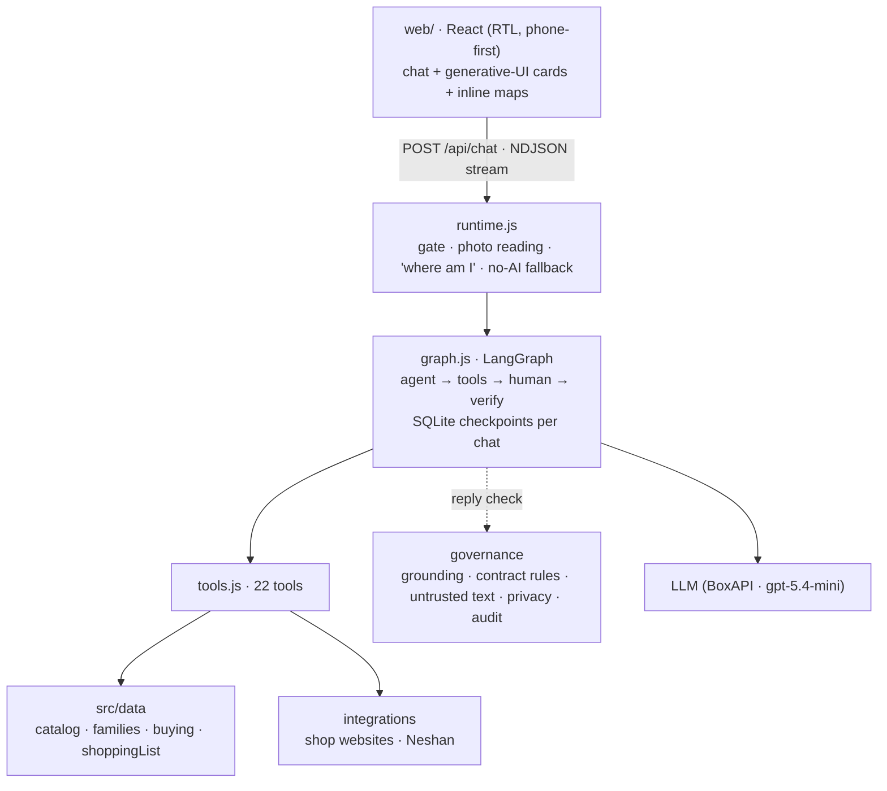

# Architecture

ترب‌چین is one Node.js service. It serves a React app and runs a LangGraph agent over a read-only SQLite copy of the Torob hackathon dataset. The model chooses what to do. Fixed code decides every number, distance and opening time that the user sees.

## The agent graph

1. **agent:** the model reads the conversation (the last 8 user turns) and the context: time in Tehran, the user's place and the dataset coverage there, the user's name, and how old the data is. It then calls tools or answers.
2. **tools:** they run with timeouts and retries, and their inputs are checked against zod schemas. Per-turn limits apply: 3 searches, and each result card at most once. The `0 = no limit` normalisation also happens here.
3. **human:** `ask_user` and `request_location` pause the checkpointed graph until the user answers in the chat.
4. **verify:** the reply check (see *Harness rules*). If a rule is broken, the model is sent back once with a precise instruction. Prices and phone numbers not found in tool results are redacted.

Budgets per turn: 10 model steps, 16 tool calls, 150 seconds.

## Tools

| Kind | Tools |
|---|---|
| Data | `search_products`, `get_product_details`, `resolve_place`, `find_sellers`, `find_shops_nearby`, `find_alternatives`, `explain_term`, `get_shop_contact`, `check_shop_instagram`, `check_shop_website`, `get_followups` |
| Generative UI | `show_shop`, `show_shops`, `show_products`, `compare_products`, `compare_offers`, `price_verdict`, `plan_visit`, `plan_list`, `ask_shop` |
| Human in the loop | `ask_user`, `request_location` |

**Generative UI.** UI tools pass ids, plus (for product cards) which of the product type's fields matter most. The harness fills in the real data. The client renders only cards from an allowlist registry:
- `shop_board`, `nearby_shops`, `shop_profile`
- `product_list`, `product_compare`, `compare`
- `price_verdict`, `visit_plan`, `shopping_list`
- `followup`, `website_evidence`, `instagram_evidence`

Every card with shops has an inline map, and the map and the list are linked both ways.

## Harness rules (enforced in code, not left to the prompt)

The evals showed where prompting alone was unreliable. These rules live in `contractViolations` (`src/agent/graph.js`) and are covered by `test/rules.test.js`.

| When | The turn must end with |
|---|---|
| The user picked a product from the options | its shop list (`find_sellers`) |
| A shop is out of stock («تموم کرده»، «نداریم») | alternatives, other sellers, or a plan rebuilt around a plan-B shop |
| «X بهتره یا Y؟» with two models found | a model comparison card |
| «برنامه‌ی رفتن رو بچین» with known offers | a visit plan |
| Several items in one message («یه … ، یه … و یه …») | the shopping-list planner |
| Any reply | no question asked in plain text where a card should ask it |
| Any reply | no claim that ترب‌چین contacted a shop (it never sends messages) |
| Location known | no asking for it, and never calling it unknown |

Other code paths that skip the model or a model round:
- «من کجام؟» is answered from saved state with no model call.
- When one exact model matches and the location is known, the search returns its shops directly, which saves a model round.
- When nobody lists a product, the shop search adds alternatives itself.

## Fallbacks

- **Model unavailable** (out of credit, provider down, timeout): the same message gets a direct catalogue answer, either its shop list and map, nearby shops by kind, or product options, with an honest note. It is saved to history (`directAnswer` in `src/agent/tools.js`).
- **Maps:** Neshan when its keys are accepted, otherwise OpenStreetMap tiles (`/api/maps`).
- **Place search:** Neshan → the dataset's own areas → OpenStreetMap Nominatim.

## Data layer (`src/data`)

| Module | Responsibility |
|---|---|
| `catalog.js` | FTS5 product search (Persian normalisation, type-aware: «گوشی ساده» stays in phones), offers with filters, opening hours in Tehran time, visit time, coverage, plan B, shop pages, shops by kind |
| `families.js` | Product types (phone, laptop, shoes, clothing, headphones, TV, fridge): which spec fields matter, sizes and colours, comparison winners, in-shop checklists |
| `buying.js` | What a warranty means, seller claims on phone listings, bargaining ranges, "when to go" advice, a glossary |
| `shoppingList.js` | Several items in one trip: one shop, one passage, or the cheapest mix |

## Governance

- **Grounding:** every price and phone number in a reply must come from a tool result in the conversation.
- **Untrusted text:** seller descriptions, shop websites and pasted shop replies are sanitised and labelled as data.
- **Privacy:**
  - location is coarsened to about 100 m;
  - the user's name is letters only and at most 24 characters;
  - photos are read and then discarded, never stored;
  - phone numbers never appear in logs.
- **Operations:** per-user rate limits, a kill switch (`AGENT_ENABLED=false` or `data/KILL_SWITCH`), an append-only audit log, per-turn traces with an `/admin` viewer, and CSP and security headers.

## Storage

| What | Where |
|---|---|
| Dataset | `/app/db/torob.db`, read-only and baked into the image |
| Chats (checkpoints), follow-ups, traces, audit log | `DATA_DIR`, a Liara disk in production |
| Chat list, theme, name, location | the browser's local storage |
